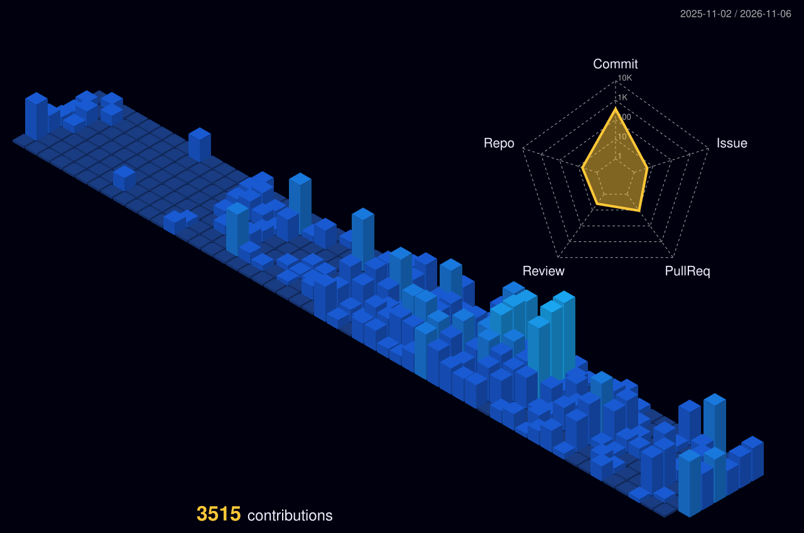

<!-- Illo illo illo 🗣️ -->

```text
               __
        ___.--'  `--.___        erik@workstation:~$ neofetch
      .'  .--. __ .--.  `.      ----------------------------
     /  .'  .-'  `-.  `.  \     OS: ................ HawaiiOS
       /  .'  (oo)  `.  \       Role: .............. Software and Simulation Engineer
      '  /    //    \  '        Base: .............. Bavaria, Germany
             //                 Work: .............. FERCHAU GmbH (since Oct 2026)
            //                  Before: ............ 3D pipeline validation, Paradox Cat (2026)
           ((                   Study: ............. BSc (Hons) Computer Science, CCCU · 2026–27
            \\
             \\                 Focus.Graphics: .... Vulkan, SPIR-V, Direct3D 12 / 9, Ramses
         _____))_____           Focus.Reversing: ... native rehosting, engine diagnostics
      ~~~~~~        ~~~~~~      Focus.Tooling: ..... validation, runtime diagnostics, test automation
                                Languages: ......... C++17/20, Python, C#, CMake
                                Tools: ............. Ghidra, RenderDoc, Qt, Git
                                Motto: ............. "looks right" is not a test result

                                🟥🟧🟨🟩🟦🟪⬛⬜
```

<p align="center">
  
</p>

<p align="center">
  
</p>
